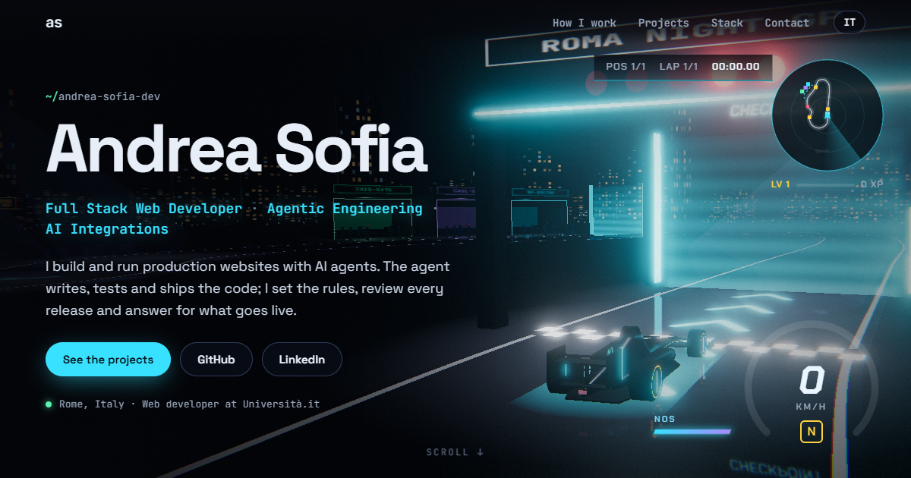

# andrea-sofia-dev.github.io

My portfolio as a small 3D scene: a terminal where an AI agent ships a change, my projects orbiting around it,
and the tools I use as a constellation. Scroll, and the camera flies from one to the next.

**Live: [andrea-sofia-dev.github.io](https://andrea-sofia-dev.github.io)**



## What's in it

- **Three.js, no framework.** About 10 KB of JavaScript for the page itself; Three.js (~150 KB gzipped) loads
  after the text, in its own chunk.
- **The terminal is a canvas texture.** The session is typed one character at a time and the texture is redrawn
  only when something changes.
- **Scroll drives the camera.** Each section has a shot; the camera holds while the section is centred and flies
  between shots. The mouse adds a little parallax.
- **Cards and 3D are linked.** Hover a project card and its node lights up; click a node and its card scrolls into
  view. Labels fade when a node passes behind the monitor.
- **Two languages**, English and Italian, picked from the browser and switchable.
- **The project list keeps itself up to date.** Featured projects are hand-written cards. Any other public
  repository of mine tagged with the `portfolio` topic shows up under "More projects" on its own (see below).

## More projects, automatically

1. On GitHub, add the topic `portfolio` to a repository (the gear next to "About" → Topics). Its description, main
   language, stars and website (if it isn't on github.com) are what the card shows.
2. That's it. The site is rebuilt every day at 05:23 UTC, on every push, and whenever you click "Run workflow" in the
   Actions tab.

How it works: before each build, [`scripts/fetch-projects.js`](scripts/fetch-projects.js) reads my repositories from
the GitHub API and saves the tagged ones to `src/generated/projects.json`; a small Vite plugin,
[`scripts/more-projects.js`](scripts/more-projects.js), writes them into the HTML. The list is part of the page, so it
reads without JavaScript and visitors' browsers never call GitHub. If the API can't be reached, the last saved list is
kept and the build still succeeds. With nothing tagged, the section isn't shown at all.

Good to know: GitHub pauses scheduled workflows in repositories with no activity for 60 days. If the list stops
updating, open the Actions tab and re-enable the workflow (or push anything).

## Accessibility and performance

- Text first: all the content is plain HTML, readable before the 3D loads and without WebGL at all.
- `prefers-reduced-motion`: no camera flights and no idle animation. The scene cuts between shots and renders only
  when something changes.
- If the first frames are slow, the bloom is turned off and the resolution drops to 1×.
- Self-hosted fonts. No cookies, no analytics, no requests to third parties.

## Run it

```bash
git clone https://github.com/andrea-sofia-dev/andrea-sofia-dev.github.io.git
cd andrea-sofia-dev.github.io
npm install && npm run dev
```

`npm run build` refreshes the project list and writes the site to `dist/`. `npm run projects` only refreshes the
list. `npm run check` fails if a text has no Italian translation. GitHub Actions deploys to GitHub Pages on every push
to `main`, every day, and on demand.

## How it was built

Agentically, with Claude Code. I set the goal and the constraints (text first, no trackers, works on a phone) and
reviewed each step. The agent wrote the code, then checked it in headless Chrome at desktop and phone sizes:
a screenshot of every section, console errors, horizontal overflow. Then it fixed what it found.

## Structure

```
index.html        page content (English) and meta tags
src/main.js       language switch, scroll → camera, card ↔ node links
src/scene.js      Three.js scene: camera shots, orbits, bloom, labels
src/terminal.js   the typed terminal (canvas texture)
src/content.js    projects, skills, terminal script, Italian text
src/style.css     layout and theme
src/generated/    projects.json, the tagged repositories (written by the build)
scripts/          fetch-projects.js, more-projects.js (Vite plugin), check-i18n.js
```

## License

Code: [MIT](LICENSE). Text, name and images: © Andrea Sofia.
